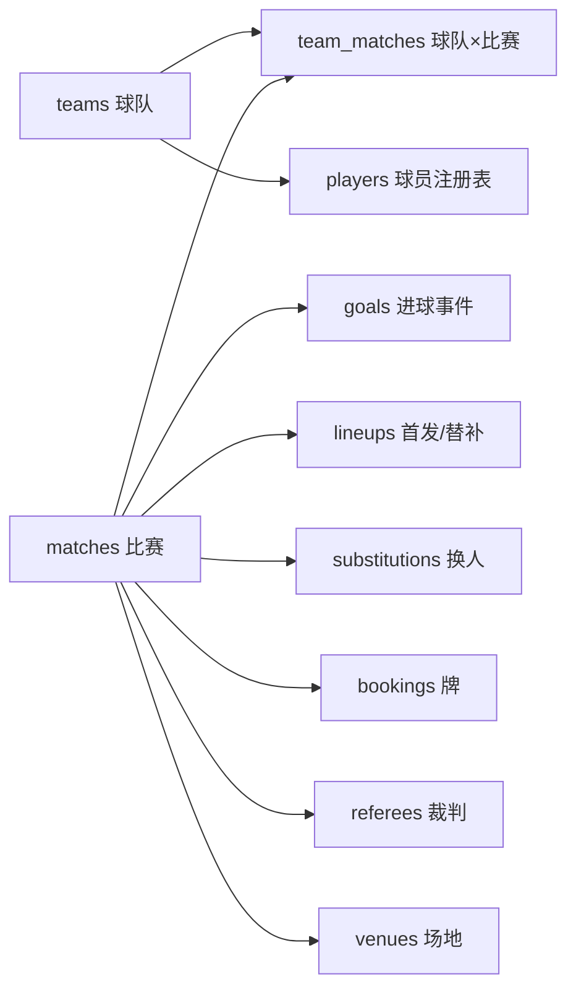
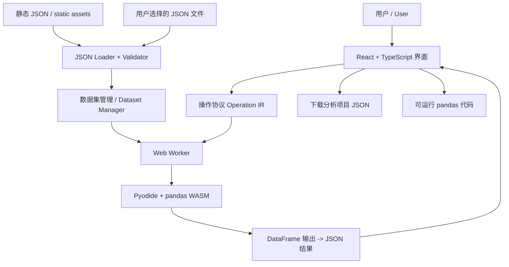

# World Cup × pandas：纯前端可视化数据分析平台

> **详细产品、数据、交互与技术实施方案**  
> 版本：1.0 · 编写日期：2026-10-14 · 产品语言：简体中文 / English  
> 约束：**无业务后端、无数据库服务、数据以 JSON 文件为唯一持久化交换格式、默认提供 2026 世界杯数据**。  
> 开发目标：可运行的专业数据分析应用，而非世界杯页面与 pandas API 的简单拼接。

---

## 0. 一页摘要 / Executive Summary

**产品名称（暂定）：World Cup Data Lab / 世界杯数据实验室。**

本项目以 2026 世界杯为默认分析语境，构建一个可以自由加载其他 JSON、CSV、Excel 等来源（导入后转换为内存 DataFrame，最终持久化/导出为 JSON）的通用可视化数据分析平台。用户可以点击图形、拖拽字段、选择操作卡片，获得 pandas 真实计算结果，并看到对应代码；复杂分析允许在受控环境下执行代码。

**必须坚持的产品不变量：**

1. **世界杯是问题与数据，不是 pandas 教程的皮肤。** 如“为何晋级”“谁得分更有效率”“什么时候最容易进球”等问题驱动每一个操作。
2. **图形是操作入口，不只是最终结果。** 图表点击、框选、下钻、分层比较，都可以更新底层筛选与数据变换工作流。
3. **同一份数据，同一套计算。** 所有支持的可视化操作先生成结构化操作描述（Operation IR），再交给浏览器里的真实 pandas 执行；生成的 Python 代码与计算结果必须一致。
4. **数据优先于视觉。** 源数据不存在的射门坐标、xG、跑动距离、传球线路不能制造；相应图形应禁用并解释原因。
5. **完全静态部署。** React 前端、JSON 文件、Pyodide WebAssembly、Web Worker。无需 API 服务或运行中 Node 服务。
6. **双语内容等价。** 中英文展示、教程、解释、错误提示、导出报告具有相同信息量、相同指标含义与相同交互能力。

**最推荐的实现组合：** React + TypeScript + Vite + Tailwind/shadcn/ui + ECharts + React Flow + TanStack Table + Pyodide(pandas) + Web Worker + JSON。

---

## 1. 交付数据：实际有什么，缺少什么？

### 1.1 本压缩包已经包含的离线默认数据

`public/data/2026/` 中含可直接加载的 **2026 世界杯真实比赛记录离线子集**，并非虚构示例：

| JSON 文件 | 记录量 | 内容 | 是否真实赛事数据 |
|---|---:|---|---|
| `matches.json` | 26 | 比赛：A/B/C 三个完整小组的 18 场 + 8 场后期淘汰赛样本 | 是，子集 |
| `team_matches.json` | 52 | 每场比赛拆为两条球队视角记录 | 是，从比分派生 |
| `goals.json` | 78 | 进球球员、分钟、点球、乌龙球 | 是，按上游展开 |
| `teams.json` | 18 | 离线样本涉及的球队、中文和英文名称 | 是；翻译为显示元数据 |
| `venues.json` | 15 | 上游场地名称（无未经核实的坐标） | 是；坐标缺失 |
| `source_seed.json` | 26 | 用于核对与再生成的上游结构子集 | 是，经过人工抽取 |
| `manifest.json` | 1 | 数据表清单、默认数据、缺失能力与远程源 | 配置 |
| `sources.json` | 1 | 来源、许可、数据版本说明 | 元数据 |
| `diagnostics.json` | 1 | 行数、质量检查、可用性 | 质量报告 |
| `data_dictionary.json` | 1 | 中英双语字段字典 | 文档数据 |
| `pandas_atlas.json` | 43 | 43 个可视化 pandas 操作主题 | 产品配置 |
| `analysis_recipes.json` | 12 | 12 套世界杯问题导向分析模板 | 产品配置 |
| `visualization_presets.json` | 11 | 11 套图表预设 | 产品配置 |
| `cleaning_practice_synthetic.json` | 5 | 特意加入缺失、重复、脏值的练习数据 | **明确标记为虚构** |

**重要：26 场不是完整 104 场。** 首页显示“离线子集 · 26/104 场”，不得让用户误以为这是整届世界杯。只在用户下载/打包完整 JSON 之后才显示“104 场赛事完整数据”。

默认子集为何这样选：

- 小组 A、B、C 的全部 18 场比赛适合学习真实的小组排名、`groupby`、`pivot_table` 与日期变化；
- 后 8 场淘汰赛适合说明 `ft`（90 分钟）、`et`（加时后）、`p`（点球大战）及晋级关系；
- 78 个真实进球事件适合 `explode`、分钟解析、分桶、进球热图与下钻；
- 不提供的控球率、射门、xG 统一记为 `null`，不能填零；
- 附加的**合成数据**仅用于演示缺失值/重复数据处理，在 UI 中单独标为 Synthetic / 虚构练习。

### 1.2 如何在“没有后端”的情况下得到完整 104 场

**本包包含 `scripts/build-worldcup.mjs`，这是一次性的本地/CI 构建脚本，不是网站后端。**

```bash
# 在项目根目录执行；需要 Node.js 18+、可访问 GitHub Raw 的网络
node scripts/build-worldcup.mjs
```

脚本将从已核实的公开 JSON 来源拉取数据：

- 基础赛程、比分、进球：`https://raw.githubusercontent.com/openfootball/worldcup.json/master/2026/worldcup.json`
- 详细比赛记录（首发、替补、换人、纪律事件、观众等）：`https://raw.githubusercontent.com/openfootball/worldcup.json/master/2026/worldcup-full.json`
- 球队名单（号码、位置、俱乐部、出生日期）：`https://raw.githubusercontent.com/openfootball/worldcup.json/master/2026/worldcup.squads.json`

脚本会在 `public/data/2026/full/` 创建 **只包含 JSON 文件**的完整数据包：

```text
full/
├── manifest.json
├── matches.json            # 预计 104 条
├── team_matches.json       # 预计 208 条
├── goals.json
├── teams.json              # 预计 48 支参赛球队（以源实际数据为准）
├── venues.json
├── players.json            # 阵容文件可用时生成
├── lineups.json            # 详细版可用时生成
├── substitutions.json
├── bookings.json
├── referees.json
└── shootouts.json
```

转换时强校验：**必须为 104 场比赛且球队视角必须为 208 条**，否则拒绝输出“完整”数据，防止源数据变化后悄悄发布错误产物。扩展表若源文件临时不可达，脚本仍生成相应空表并在清单中将功能标记不可用。下载时间与内容 SHA-256 写入 `full/manifest.json`，便于溯源和版本锁定。

如果 CI/开发机无法联网，也支持将三个上游 JSON 自己下载到本地后执行：

```bash
node scripts/build-worldcup.mjs \
  --base ./downloaded/worldcup.json \
  --details ./downloaded/worldcup-full.json \
  --squads ./downloaded/worldcup.squads.json
```

**上线推荐顺序：** 构建时拉取、校验、生成完整静态 JSON → 一起打包部署 → 浏览器优先读取 `data/2026/full/manifest.json` → 不存在时回退到随包提供的 26 场离线子集并显示清晰提醒。上线后网页不必请求 GitHub。

可额外提供“从公开源更新”按钮：浏览器通过 `fetch` 获取远程 JSON，在内存中转换并让用户下载新版本 JSON。注意外部网络/CORS 不保证总可用，这只是可选路径，不应作为唯一启动依赖。

### 1.3 来源和使用许可

主数据来自 [openfootball/worldcup.json](https://github.com/openfootball/worldcup.json)；项目在 README 中将其数据和格式声明为公共领域（Public Domain）。本方案按此来源进行数据处理，仍建议保留项目链接、获取日期、SHA-256 和原始字段值以便追踪。并非 FIFA 官方统计数据库。

**覆盖范围：** 公开基础文件包含比分/进球；详细文件包含首发、替补、换人、黄红牌、裁判、部分赛后信息；阵容文件包含注册球员。它们**不等于**逐次传球、每脚射门坐标、xG 或位置追踪服务。对没用实际数据支持的高级战术功能，直接显示“当前数据不可用 / Unavailable in this dataset”。

---

## 2. JSON 数据建模：怎样让 pandas 自然发挥能力

### 2.1 不使用一张超级宽表

**标准星型/关系数据：**



每个 JSON 格式统一为：

```json
{
  "schema_version": "1.0.0",
  "dataset_id": "fifa-world-cup-2026-offline-seed",
  "table": "matches",
  "meta": {
    "scope": "partial_verified_sample",
    "row_count": 26
  },
  "rows": [
    {
      "date": "2026-06-11",
      "team1_name": "Mexico",
      "team2_name": "South Africa",
      "ft1": 2,
      "ft2": 0,
      "ht1": 1,
      "ht2": 0,
      "stage": "group",
      "group": "Group A"
    }
  ]
}
```

该 `rows` 示例仅展示关键字段，真实文件还有稳定主键、UTC 时间、加时、点球、场地等字段。

### 2.2 五张基础分析表

**A. `matches` / 比赛事实表**

**一行 = 一场比赛。** 主键 `match_id`，关联两支球队 `team1_id`、`team2_id`。重要字段：

`date, local_time, kickoff_utc, group, stage, team1_id, team2_id, ht1, ht2, ft1, ft2, et1, et2, penalties1, penalties2, winner_id, venue_id, attendance`

**B. `team_matches` / 球队比赛事实表**

**一行 = 一支球队参加的一场比赛。** 复合唯一键 `(match_id, team_id)`，字段：

`team_id, opponent_id, date, group, stage, goals_for_90, goals_against_90, goals_for_final, goals_against_final, result_90, win, goal_difference_90`

这样 `groupby("team_id")`、`rolling(3)`、`pivot_table` 就会非常自然。不要将数据中原始 `team1/team2` 顺序误解释为俱乐部联赛的主客场优势。

**C. `goals` / 进球事件表**

**一行 = 一个记入比分的进球。** 主键 `event_id`，关联 `match_id`：

`scoring_team_id, player_team_id, player_name, minute_label, minute_base, minute_added, phase, is_penalty, is_own_goal, x, y, xg`

注意：`minute_label = "90+4"`，并非浮点数 90.4。`minute_base = 90`、`minute_added = 4`、`phase = second_half`。分桶应以比赛阶段与基础分钟明确处理。由于没有坐标，`x/y/xg = null`。

**D. `teams` / 球队维表**：`team_id, name_en, name_zh, group`，中英文名称只是标签，不参与关联键计算。

**E. `venues` / 场地维表**：`venue_id, name_en, name_zh, latitude, longitude, geo_verified`。缺失经纬度时，使用场地列表/柱图，不生成假坐标点。

### 2.3 完整版扩展表

完整构建脚本进一步生成：

| 表 | 主键/关联 | 支持的问题 |
|---|---|---|
| `players` | `(team_id, number)` 形成的 ID | 球员年龄、俱乐部、位置分布 |
| `lineups` | `match_id, team_id, role, order` | 首发阵容与替补结构 |
| `substitutions` | `event_id` | 换人时间分布、比赛事件时间线 |
| `bookings` | `event_id` | 黄牌/红牌按队和比赛阶段分布 |
| `referees` | `match_id` + 顺序 | 裁判与比赛的关系分析 |
| `shootouts` | `match_id, sequence` | 点球大战进程，只有源明确的信息才显示 |

**跨来源球员姓名可能有转写/大小写差异**（如比赛记录与注册名单），不能直接假定姓名字符串相同就代表同一人。完整版保留原始 `player_name`，提供待人工审查的匹配层，未经核对不自动制造确定的 `player_id` 对应关系。

### 2.4 数据语义与口径必须固定

| 指标 | 正确定义 | 错误示例 |
|---|---|---|
| 90 分钟进球 | `ft1 + ft2` | 与加时后比分混算 |
| 最终比分 | 若有 `et` 用 `et`；否则 `ft` | 将点球大战的比分加到进球数 |
| 晋级/胜者 | 先看加时后比分；仍平则看点球大战 | 只看 `ft` 判断胜者 |
| 乌龙球 | `scoring_team_id` 是得分球队，`player_team_id` 是球员本队 | 把乌龙球算作球员本队得分 |
| 进球效率 | 仅在射门次数可信时定义 `goals/shots` | 没有射门数据时以零代替 |
| 比赛走势 | 实际事件/指标的时间序列 | 根据赛果倒推虚假的“场面压制” |
| 控球率、xG | 来源明确提供时才能分析 | 用进球替代 xG 或捏造统计 |

除非指标具有真实来源，否则卡片显示“暂不可计算”，而不是 `0`。

---

## 3. 网站信息架构 / Site Map

### 3.1 六个顶层页面

| 中文 | English | 一句话定位 |
|---|---|---|
| 赛事总览 | Tournament Overview | 用问题驱动的赛事视图进入分析 |
| 分析工作台 | Analysis Studio | 完成数据查看、变换、图表、代码全闭环 |
| 数据实验室 | Data Lab | 数据载入、清洗、联接、字段类型管理 |
| 比赛探索 | Match Explorer | 比赛时间轴、阶段、球队与进球事件下钻 |
| 分析故事 | Analysis Stories | 可编辑可复现的案例，不是静态教程 |
| pandas 方法图谱 | pandas Atlas | 由方法找问题、由问题找方法 |

建议默认打开 **赛事总览**，但页面每一张图表都有明显的“在工作台分析 / Analyze in Studio”入口，并将当前筛选状态一同传入。

### 3.2 默认首页

首屏：

- 左侧：品牌/导航 + 数据集状态（**完整 104 场**或**离线样本 26/104 场**）。
- 中间上：主要赛事数字、胜者与比分口径说明；数据日期/来源提示。
- 中间下：世界杯淘汰赛树、日历进球图和小组对比。
- 右侧：操作式分析问题卡，比如“哪支球队在下半场最能进球？”
- 底部：热门分析故事和「打开你自己的 JSON 文件」。

**强制要求：** 首页默认图表的排名、赛果和数量都必须由已加载的 JSON 算出。加载离线子集时所有跨赛事结论必须提示样本范围；不要显示“2026 完整球队排行榜”。

### 3.3 关键工作台结构

```text
┌────────────────────────────────────────────────────────────────────────────┐
│ Logo     数据集▼   赛事总览 / 分析工作台 ...      撤销 ↶  保存JSON  中文/EN │
├───────────────────┬──────────────────────────────────────┬─────────────────┤
│ 数据与字段（20%） │             可视化分析画布（55%）       │ 操作与属性（25%）│
│                   │                                      │                 │
│ matches           │ [联动图表]  [透视表]  [比赛阶段图]      │ 筛选器           │
│ team_matches      │                                      │ 分组与聚合       │
│ goals             │ [点击筛选] [刷选] [下钻] [对比]        │ 排序与计算       │
│ teams             │                                      │ 时间窗 / 图表设置 │
│ 自己上传的表       │                                      │                 │
├───────────────────┴──────────────────────────────────────┴─────────────────┤
│ 工作流节点  |  结果数据预览  |  pandas 代码  |  日志与数据质量               │
└────────────────────────────────────────────────────────────────────────────┘
```

布局可拖动改宽；左侧与底部可一键折叠；键盘搜索功能比菜单逐级点击优先。

---

## 4. 最关键的设计：图形就是 DataFrame 的操作界面

### 4.1 图表交互映射

| 可视化动作 | pandas 计算 | 用户看到什么 |
|---|---|---|
| 点击某球队柱子 | `df.query("team_id == ...")` | 所有图表筛选至该队 |
| 散点框选一组比赛 | `df.loc[mask]` | 选择子集与记录详情 |
| 时间轴拖拽区间 | datetime 条件筛选 | 场次/进球时间段同步变化 |
| 将“球队”拖至分组栏 | `groupby("team_id")` | 动态排行和汇总卡片 |
| 把“分组”“赛事阶段”拖到矩阵坐标 | `pivot_table` | 交互式热力图 |
| 连接球队表和比赛表 | `merge` | 连线、匹配率、误关联风险 |
| 直方图拖动边界 | `cut` / `qcut` | 各分桶样本即时更新 |
| 时间窗调为最近 3 场 | `rolling(3)` | 球队阶段性曲线 |
| 点击箱线图离群点 | `loc` + 行定位 | 下方跳转至原始记录 |
| 对某字段点击“缺失分布” | `isna` | 缺失矩阵，禁止伪装成0 |

这些操作应通过**同一个 AnalysisSession 状态**维护，保证多图联动，而不是各图维护各自筛选。

### 4.2 “分析透镜”菜单

每个可选择的数据点拥有五个上下文动作：

1. **钻取 / Drill down**：组 → 球队 → 比赛 → 事件；
2. **比较 / Compare**：放入多选比较篮，生成对照视图；
3. **分解 / Break down**：更换分组维度；
4. **解释 / Explain**：显示样本量、分布、异常、数据质量；
5. **查看计算 / Inspect computation**：打开结果表、公式和 pandas 代码。

### 4.3 12 套随数据提供的分析模板

真实数据中可以按以下问题组织分析：

- 世界杯全局概览 / World Cup Overview
- 球队晋级之路 / Team Journey
- 进球贡献与射手榜 / Goal Contributions and Scorers
- 进球分钟及伤停补时 / Goal Timing
- 小组比赛矩阵 / Group Results Matrix
- 最近三场球队走势 / Recent Three Match Form
- 比赛 → 事件下钻 / Match Detail Drilldown
- 比赛与球队联接实验 / Visual Join Lab
- 缺失值与质量审计 / Data Quality Audit
- 常规时间与淘汰赛胜负 / Knockout Outcomes
- 场地进球对比 / Goals by Venue
- 代码—图形同步 / Code and Visual Sync

对应 JSON 配置见 `analysis_recipes.json`；图表定义见 `visualization_presets.json`；可运行的工作流结构示例见 `example_project.json`；通用数据表 JSON Schema 见 `table.schema.json`。

**说明：** 模板在离线子集上都可演示相应技术，但赛事覆盖不完整的模板需明显提示“部分样本”。淘汰赛完整树必须等待完整版 104 场；否则只绘制“已加载的淘汰赛样本”，不能虚构缺失节点。

---

## 5. pandas 功能与视觉系统的完整覆盖策略

> 目标是 **广泛覆盖 pandas 的常用与高级能力**，不是声称“所有 API 都能无损双向转成图形”。43 个代表性操作领域的完整清单已写入 `pandas_atlas.json`。

### 5.1 基础功能 / Essential

`head, tail, sample, info, describe, shape, dtypes, loc, iloc, query, isin, between, sort_values, nlargest, nsmallest, set_index, reset_index`

**可视化：** 可搜索列选择器、操作条件 Builder、动态数据网格、字段类型图、排序排行榜、异常点下钻。

### 5.2 清洗与转换 / Cleaning

`isna, notna, fillna, dropna, duplicated, drop_duplicates, rename, astype, to_numeric, to_datetime, str.*, replace, clip, round`

**可视化：** 缺失矩阵、重复键检测器、类型转换前后对比、正则规则预览、数据质量计分卡。

### 5.3 分组、汇总、关联 / Aggregation & Joining

`groupby, agg, transform, filter, value_counts, crosstab, merge, join, concat, pivot_table`

**可视化：** 行列字段货架、可拖拽关联画布、行数膨胀提醒、透视表、矩阵热图、分组比较图。

### 5.4 数据重塑 / Reshaping

`melt, pivot, stack, unstack, explode, json_normalize, MultiIndex`

**可视化：** 宽长表结构变形动画、数组展开树、嵌套字段映射器、层级表格。

### 5.5 时间与窗口 / Time & Window

`dt.*, resample, shift, diff, rolling, expanding, ewm, pct_change, cumsum, cumcount`

**可视化：** 时间粒度控制、滚动窗口滑块、对齐比较、累计面积、排名变化曲线。

### 5.6 数值、统计和高级函数 / Numerical & Advanced

`rank, cut, qcut, corr, cov, quantile, std, var, assign, eval, apply, map, pipe`

**可视化：** 相关热图、箱线图、散点矩阵、区间分桶、公式节点、操作 DAG。

### 5.7 代码编辑模式

- **可视化优先**：由图形产生确定性的工作流节点；
- **参数优先**：高级操作的参数由表单生成；
- **代码优先**：用户自行输入 pandas 代码；
- **结果统一**：无论入口，结果都以 DataFrame → JSON 预览 → 图表绘制；
- **可视化反向解析的边界**：仅受支持的操作可从代码解析回拖拽节点；任意 Python 代码保持为 `CustomPythonNode`，不假装可逆。

特别注意：Pyodide 里 pandas 的许多核心操作可用，但受限于浏览器虚拟文件系统、内存、额外依赖和运行时环境，**不能声称支持整个 CPython 生态中的全部 I/O/原生扩展**。

---

## 6. 重点场景如何“自然用到” pandas

### 故事 A：一支球队的晋级之路

1. 用户从赛事树选择 Spain（在完整数据中）。
2. 系统查询 `team_matches` 中该队的全部比赛，按日期排序。
3. 用户切换“90 分钟结果 / 最终结果”，系统显示两个不同口径。
4. 用户点击某场比赛，进入 `goals` 事件时间轴。
5. 将选定球队加入对比篮，汇总各队小组赛与淘汰赛成绩。
6. 系统用柱图/阶梯图解释差异，并显示 pandas 工作流。

自然使用：`query` → `sort_values` → `merge` → `groupby` → `pivot_table`。

### 故事 B：进球效率为什么不能直接看进球榜？

1. 先按球队做总进球排行；
2. 引入参赛场次数，改为场均进球；
3. 用不同阶段筛选，比较统计口径改变时排名是否变化；
4. 如果射门数据没有接入，**禁用“射门转化率”按钮**，解释目前只能讨论“每场进球数”，不能讨论真正射门效率；
5. 如果用户上传具有可信 `shots` 列的补充数据，再开放 `goals/shots` 计算。

自然使用：`groupby`, `agg`, `assign`, `sort_values`, `merge`，也体现数据分析对字段真实性的要求。

### 故事 C：比赛时刻与结果变化

1. 打开 `goals` 分钟直方图；
2. 区分上半场、下半场、加时赛及补时阶段；
3. 框选“90+”进球事件，下面联动显示比赛列表；
4. 按小组、球队、赛事阶段分层查看；
5. 解释样本大小对结论的限制。

自然使用：`str`, `astype`, `cut`, `query`, `groupby`, `merge`, `value_counts`。

### 故事 D：关系图是怎样发现错误关联的？

`matches.match_id` 与 `goals.match_id` 是一对多。如果用户错误地尝试与 `team_matches` 用 `match_id` 单列合并，可能导致一场进球同时落到两支球队记录上。界面应在执行前提示：“预估重复/行数放大风险”，推荐加上 `scoring_team_id == team_id` 或解释该关联的用途。

这个操作将 `merge(validate=...)`、重复键分析、数据语义与可视化连接起来，远比单独教学函数有价值。

---

## 7. 图形如何强化数据分析能力

### 7.1 基础图表（默认数据可用）

- 赛事阶段树：可交互层级导航；
- 赛事时间轴：日期与比赛；
- 进球分钟直方图：点击 bin 反向筛选赛事；
- 分组热力图：小组/球队/进球/胜平负；
- 坡度图：对比不同排名或阶段；
- 箱线图：球员/球队数据分布与异常值；
- 散点图：两个可信数值指标之间的关系；
- 关系网络：`matches`、`teams`、`goals` 的数据连接；
- 缺失值矩阵：说明某些高级指标不可获得；
- 流程节点图：每一步 DataFrame 变换。

### 7.2 足球场图形（有数据才解锁）

| 可视化 | 需要的字段 | 本次提供数据是否支持 |
|---|---|---|
| 射门落点 / Shot map | 射门坐标、球队、球员、比赛 | **不支持** |
| xG 气泡图 / xG plot | 每脚射门 xG 与来源 | **不支持** |
| 传球网络 / Pass network | 传球起终点、球员 ID、接收方 | **不支持** |
| 位置热力图 / Positional heatmap | 时空追踪或事件坐标 | **不支持** |
| 首发阵容卡 / Lineup board | 首发球员、球队、比赛 | **完整版详细源支持**，但没有经核实阵型坐标 |
| 进球事件时间线 / Goal timeline | 时间、球队、球员 | **支持** |
| 牌/换人事件时间线 / Cards & subs | 事件时间、球队、球员 | **完整版详细源支持** |

请不要把“阵容名单”假装成真实位置坐标，也不要根据主观判断绘制球队传球网络。没有坐标仍然可以做漂亮且有意义的事件时间线和阵容列表。

### 7.3 数据图形与统计图形同时出现

一张图表最好有两个层次：

1. **主图：** 直观解答问题，如球队进球排行；
2. **解释层：** 显示样本数、离群点、数据缺失、统计口径、选中数据行。

例如“场均进球最高球队”图，可以并列标示每支球队的比赛场次，避免把参加 1 场比赛的球队和参加 7 场比赛的球队当成一样可靠。

---

## 8. 纯前端技术方案 / Frontend-Only Architecture

### 8.1 系统结构



**没有 FastAPI、Python 服务、SQL 服务端、在线用户数据库。** Pyodide 在客户端的 Worker 中运行真正的 pandas。静态文件可以部署在 GitHub Pages、Cloudflare Pages、Netlify、Vercel 静态模式或任意静态 HTTP 服务器。

### 8.2 各技术职责

| 层 | 技术 | 职责 |
|---|---|---|
| 壳与布局 | React + TypeScript + Vite | 页面状态、文件上传、国际化、交互 |
| UI | Tailwind + shadcn/ui | 控件、弹窗、表单、深浅主题 |
| 图形 | ECharts | 常规图表、brush、tooltip、数据联动 |
| 关系/DAG | React Flow + SVG | 数据表关系和分析工作流 |
| 大数据表 | TanStack Table + virtual | 排序、冻结、筛选、可视化字段拖拽 |
| 计算 | Pyodide + pandas + numpy | 可执行 pandas 数据处理 |
| 隔离线程 | Module Web Worker | 避免计算阻塞主线程 |
| 数据 | JSON in `public/data` | 唯一部署时持久化数据格式 |
| 项目保存 | JSON 文件导入/导出 | 跨浏览器可移植的分析过程 |
| 国际化 | i18next | 每条内容键 zh/en 双语 |

### 8.3 浏览器加载流程

1. 先加载小型 `manifest.json` 与已生成的 `analysis_recipes.json`；
2. 优先探测完整版 `data/2026/full/manifest.json`；
3. 存在并通过 104/208 条的清单检查则作为默认数据；否则加载离线 26 场；
4. 默认图表使用静态 JSON 直接渲染（提升首屏速度）；
5. 后台初始化 Pyodide + pandas Worker，显示可见的加载进度；
6. 用户开始计算时将需要的源表送进 Worker，一次装载、多次复用；
7. 操作产生 JSON 结果，由 ECharts 和表格渲染；
8. 用户可将输入数据源、操作节点、参数、图表配置、语言选项导出为分析项目 JSON。

**部署子路径兼容性：** 不能在代码中写死 `/data/...`，应该以 Vite 的 `import.meta.env.BASE_URL` 拼接 `manifest.tables[*].path`（后者是不带起始 `/` 的相对路径）。

### 8.4 数据加载示例

```ts
interface DataTable<T = Record<string, unknown>> {
  schema_version: string;
  dataset_id: string;
  table: string;
  rows: T[];
}

const base = import.meta.env.BASE_URL;
const url = (path: string) => `${base}${path.replace(/^\//, "")}`;

async function loadTable<T>(relativePath: string): Promise<DataTable<T>> {
  const response = await fetch(url(relativePath));
  if (!response.ok) throw new Error(`JSON not found: ${relativePath}`);
  const doc = await response.json();
  if (!Array.isArray(doc.rows) || typeof doc.table !== "string") {
    throw new Error("Invalid dataset schema");
  }
  return doc as DataTable<T>;
}
```

用户本地上传 JSON 使用 `<input type="file" accept=".json,application/json">` + `File.text()` + JSON Schema / Zod 验证。CSV、Excel 的**导入解析**可以作为可选客户端插件，但规范化、会话保存、导出仍统一为 JSON，满足“数据只有 JSON 格式存储”的约束。

### 8.5 如何在浏览器运行真正的 pandas

建议安装 Pyodide 的固定生产版本，`loadPackage("pandas")`，使用 **module type Web Worker** 执行。其处理流程如下（示意）：

```ts
// pandas.worker.ts - 示意；生产版添加任务取消、超时与异常捕获
import { loadPyodide } from "pyodide";

let runtime: Awaited<ReturnType<typeof loadPyodide>> | undefined;

async function ensureRuntime() {
  if (!runtime) {
    runtime = await loadPyodide({
      indexURL: PYODIDE_VERSIONED_ASSET_URL // 必须使用实际固定版本的资源地址
    });
    await runtime.loadPackage(["pandas", "numpy"]);
  }
  return runtime;
}

self.onmessage = async ({ data }) => {
  const py = await ensureRuntime();
  // 此处通过 Pyodide 的 JS↔Python 桥传 JSON，
  // Worker 负责统一会话缓存、验证和执行，不在主线程计算。
  // 返回值包含 requestId, rows, columns, dtypes, warnings。
};
```

`PYODIDE_VERSIONED_ASSET_URL` 必须在工程中配置为实际安装、校验过的版本 URL；此处故意不写可能过期的 CDN 版本号。Worker 初始化时加载依赖会占用可观的网络与内存，首屏应**先显示静态图表**，而不是等待 pandas 下载完才显示页面。

### 8.6 必须清楚的浏览器限制

- 静态网站运行时**无法写回部署目录的 `public/data/*.json`**；用户修改数据的正确方式是导出项目 JSON/数据 JSON，再在构建阶段放回静态目录。
- 可以在内存里长期保持 DataFrame；关闭网页后内存消失。严格“只保留 JSON 文件”的版本不使用浏览器数据库自动保存；如未来允许本地缓存，可考虑 IndexedDB **仅存 JSON 快照**，但它不是普通静态 JSON 文件。
- Python/pandas 运行在浏览器 WebAssembly 中，单页内存与 CPU 有实际限制。超大 JSON 不宜一次全部在主线程 `JSON.parse` + 转存多份副本。
- Pyodide 默认需要下载 runtime 和 pandas wheel；若要离线可用，应将匹配的发行资源打包或由 Service Worker 预缓存。
- **Web Worker 不是不可信代码的安全隔离边界。** 允许任意 Python 时，应在隔离域/受限 iframe 中运行，采用严格 CSP，不能暴露站点令牌、私密数据或敏感浏览器权限。对不可信代码默认不开放高级执行功能。

---

## 9. 统一操作协议：实现“可视化 ↔ pandas” 的桥梁

每次交互都归一化为 **Operation IR（JSON）**，而不是直接拼接字符串。比如按球队计算 90 分钟总进球：

```json
{
  "id": "op_003",
  "type": "groupby_agg",
  "input": "table:team_matches",
  "params": {
    "keys": ["team_id"],
    "aggregations": [
      { "source": "goals_for_90", "name": "goals", "func": "sum" },
      { "source": "match_id", "name": "played", "func": "count" }
    ]
  },
  "output": "node:team_totals"
}
```

统一流水线：

```text
图形/字段拖拽
  → Schema Validation（字段可用、类型与权限）
  → Operation IR（JSON）
  → Code Generator（固定模板、白名单函数）
  → pandas Worker 运行
  → 结果 DataFrame + 计算日志
  → JSON Result + ECharts + 代码面板
```

以 pandas 显示代码：

```python
summary = (
    team_matches
    .groupby("team_id", as_index=False)
    .agg(
        goals=("goals_for_90", "sum"),
        played=("match_id", "count"),
    )
    .assign(goals_per_match=lambda d: d.goals / d.played)
    .sort_values("goals_per_match", ascending=False)
)
```

每个节点必须存储：`id, type, input, params, output, status, created_at, warnings`。保存整个 DAG 时只保存输入表指纹/相对引用、操作 JSON、图表状态与布局。自定义上传数据须同时导出源数据或提示其外部依赖，否则别人无法重现。

**代码编辑器不能伪造“双向同步”：** 受支持的方法才可由图形切换到代码再回图形。任意自定义代码存为不可逆节点，提供结果预览和继续连接的输出表。

---

## 10. 典型 pandas 示例：全部基于提供的数据列

```python
import pandas as pd, json

def table(path):
    with open(path, encoding="utf-8") as f:
        return pd.DataFrame(json.load(f)["rows"])

matches = table("public/data/2026/matches.json")
team_matches = table("public/data/2026/team_matches.json")
goals = table("public/data/2026/goals.json")

# 1. 筛选：已完成、B组的比赛
b_group = matches.query("group == 'Group B' and status == 'completed'")

# 2. 分组：各球队小组赛90分钟总进球、场数、场均进球
per_team = (team_matches.query("stage == 'group'")
    .groupby("team_id", as_index=False)
    .agg(goals=("goals_for_90", "sum"), played=("match_id", "count"))
    .assign(goals_per_game=lambda d: d["goals"] / d["played"]))

# 3. 透视：小组 × 球队的进球汇总
matrix = pd.pivot_table(team_matches.query("stage == 'group'"),
    index="group", columns="team_id", values="goals_for_90",
    aggfunc="sum", fill_value=0)

# 4. 关联：找到全部已入球的比赛场地（每球一行）
goals_at_venues = goals.merge(matches[["match_id", "venue_name", "date"]],
                              on="match_id", validate="many_to_one")

# 5. 时间：计算进球分钟数分段（补时单独标注）
goals["minute_band"] = pd.cut(goals["minute_base"],
    bins=[0, 15, 30, 45, 60, 75, 90, 105, 120, 150],
    labels=["01-15", "16-30", "31-45", "46-60", "61-75", "76-90",
            "91-105", "106-120", "121+"], include_lowest=True)

# 6. 窗口：最近3场场均进球（按球队分别滚动）
form = team_matches.sort_values(["team_id", "date", "match_id"]).copy()
form["goals_recent_3"] = form.groupby("team_id")["goals_for_90"].transform(
    lambda s: s.rolling(window=3, min_periods=1).mean())

# 7. 数据质量：缺失字段覆盖率
missing_ratio = team_matches.isna().mean().sort_values(ascending=False)
```

上述示例在**离线样本**就能运行；全量版替换加载路径即可。注意 `goals["minute_band"]` 中 45+3 与 90+4 被放到所属半场的分钟基准桶；若用户希望研究补时，需另用 `minute_added > 0` 对补时进球单独分析。

---

## 11. 双语设计 / Bilingual Parity

网站全局具备 `zh-CN` 和 `en-US` 两种语言，同一功能共用相同的 `operation id` 和数据字段，只修改**人类可见文本**。交付包另附 `public/locales/zh-CN.json` 与 `public/locales/en-US.json`，各包含 80 余个相同 key 的首批双语 UI 资源，需在开发中扩充至全量界面。

| 内容类型 | 实施规则 |
|---|---|
| 导航、按钮、弹窗 | 全部使用 `t("ui.xxx")`，禁止组件内直接硬编码中文 |
| 图表标题与图例 | 数据指标以稳定 key 标识；中英标签都由同一指标定义输出 |
| 字段与指标说明 | `data_dictionary.json` 为每个字段提供 `{zh,en}` 描述 |
| 模板和分析故事 | `{zh,en}` 在同一 JSON 对象内维护 |
| 足球术语 | 统一术语表：FT、ET、Penalties、Own goal、Group 等 |
| 球队人名 | 稳定 ID 负责关联，中文名称是可替换标签；无可靠译名时回退源名 |
| pandas API | 函数名始终是 Python 英文，提示、文档与代码注释双语 |
| 结果及导出 | 导出数据保持结构化英文键；报告说明按当前语言生成 |
| 本地化格式 | 日期、时区、千位分隔、数值精度均由 locale 渲染 |

**双语验收：** 从赛事首页 → 分组分析 → 代码预览 → 保存项目，在中文与英文下分别走完同一套 E2E 用例，比较页面动作、计算结果和提示信息覆盖率。不能只在英文页面显示占位词。

---

## 12. 视觉规范 / Visual Design System

- **品牌基调：** 深森林绿 `#1D3834`，主文本 `#111D1B`，冠军金 `#E3AD59`，暖白背景 `#F6F5F1`；深浅主题一致。
- **气质：** 面向日常长期使用的专业数据工作台，低噪声、高密度但不拥挤。
- **层级：** 重要数字清晰，操作按钮尽量靠近图表而非远离在菜单中；复杂面板默认折叠。
- **表格：** 固定列、虚拟滚动、列分组、条件高亮、缺失数据显示“—”，悬停解释“未提供”而不是 0。
- **图表：** brush、zoom、联动、聚合切换、横纵轴切换、PNG/SVG 导出、无障碍键盘导航和颜色可区分性。
- **引导：** 首次打开可选择“直接看世界杯 / 分析数据 / 导入自己的数据”，3 个入口别超过一屏。
- **显示方式：** 复杂流程尽量由图表对比、关系图和工作流 DAG 解释，不只依赖大段文字。

### 12.1 容易被忽略的专业细节

- 大图表载入时先显示空框架与真实阶段性加载状态；
- 每张图显示数据版本、统计口径、样本数、缺失字段概况；
- 图表与数据表彼此可定位：点击图表时同步高亮表格行；
- 用户可将当前图表转为“比较卡片”，形成两队、多队的并排看板；
- 每个结论包含“显示相关 DataFrame”按钮；
- 图形动画只用于解释数据变换和时间变化，避免冗余动效。

---

## 13. 用户自定义数据与 JSON 持久化

### 13.1 导入流程

1. 用户拖入一个或多个 JSON 文件；
2. 识别 `rows` 结构、纯数组或嵌套对象；
3. 预览字段类型与唯一值，并提供嵌套数组 `json_normalize`/`explode` 向导；
4. 选择主键和关系（可选）；
5. 进入通用分析工作台；
6. 保存为标准 JSON 表或导出分析项目 JSON。

CSV/Excel 导入可以通过浏览器解析库在内存转换成 JSON rows；**不作为持久化格式**。如果需求严格限定“输入也只能是 JSON”，可先只开发 JSON 导入，后续打开额外格式导入器。

### 13.2 分析项目文件格式

```json
{
  "project_schema_version": "1.0.0",
  "name": "Team Goal Comparison",
  "locale": "zh-CN",
  "source_datasets": [
    { "dataset_id": "fifa-world-cup-2026-full", "sha256": "<source-sha256>" }
  ],
  "operations": [],
  "charts": [],
  "layout": {},
  "saved_at": "2026-10-14T00:00:00Z"
}
```

*其中 `<source-sha256>` 是占位符，不是真实数据哈希；正式导出使用清单中算得的哈希。*

允许两种导出：

- **轻量项目**：只包含数据引用、操作和布局；打开后需要相同版本的数据；
- **可移植项目**：将必要的原始 JSON rows 一并嵌入或导出多个 JSON 文件（浏览器下载可独立保存的 JSON）。

**无后端意味着项目不能神奇地跨设备自动同步。** 正式 UI 应说明这一点，提供清楚的 JSON 导入/导出入口。

---

## 14. 性能、稳定性与安全

### 14.1 性能

- 首屏使用无需 pandas 的轻量级预计算图表数据或直接从简化 JSON 统计；
- Pyodide Worker 懒加载，显示下载和初始化状态；
- 源表按需加载，缓存常用聚合结果；
- 表格只渲染当前可见行（虚拟滚动）；
- Worker 只向主线程回传展示所需的分页/图表聚合数据，避免大 DataFrame 全量复制；
- 操作节点共享 DataFrame 结果，避免每次重算从头读取文件；
- 下载与存储仅对 JSON 文件；必要时静态服务器开启 gzip/brotli 传输，文件内容仍为 JSON；
- 大于阈值的用户数据给出明确大小提示、采样预览与取消任务选项。

### 14.2 安全

- 上传 JSON 最大体积与嵌套深度限制，避免资源耗尽；
- 不能从 JSON `eval` 任意字符串作为代码；
- 可视化计算规则基于白名单函数映射；
- 自定义 Python 代码与外部第三方代码要区分信任级别，必要时隔离域执行；
- 外部 URL 导入需允许列表与清晰权限提示，不自动发送本地文件到网络；
- 项目文件无账号密码、鉴权令牌或密钥；
- CSP、来源锁定、资源完整性校验、依赖版本锁定。

### 14.3 一致性与完整性自动测试

应为每一个图形操作编写：

```text
同一数据输入
→ 可视化配置产生 Operation IR
→ pandas Worker 执行
→ 与 Python pandas 测试基准做结果比对
→ 双语标题改变但数值不改变
```

还要测试：

- `matches` 104，`team_matches` 208（完整版）；
- 每个比赛 ID 唯一，每场恰好 2 条球队视角记录；
- `goals` 对照 `ft/et` 的进球事件数（如果完整事件可得）；
- 正常进球、点球、乌龙球与伤停补时解析；
- 最终获胜者与加时/点球比分口径；
- 字段 `shots/xg/x/y` 缺失时图形禁用，不能生成虚假结果；
- `join` 对 1:1、1:n、n:n 的行数提示；
- JSON 导出→重新导入→相同结果（使用确定性算法、锁定数据版本）；
- 断网、低内存、文件解析失败、Pyodide 加载失败时的降级体验。

---

## 15. 分阶段开发清单与交付验收

### M1：静态可运行 MVP

- [ ] React/Vite 静态站点、中文/英文切换、深浅主题。
- [ ] JSON Manifest Loader + 离线 26 场样本 + 完整版优先加载机制。
- [ ] 赛事总览的核心图表与样本范围标记。
- [ ] Pyodide Worker 能加载 pandas；数据表、筛选、排序、分组、聚合工作流。
- [ ] 图形点击筛选数据并同步生成 pandas 代码。
- [ ] 基本 JSON 项目导出和重新导入。

**M1 验收：** 对小组 A/B/C 的一支球队点击、筛选、分组、钻取，可以得到相同结果表与 pandas 代码。

### M2：完整分析工作台

- [ ] 字段拖拽、可视化筛选器、聚合、多种图表与工作流 DAG。
- [ ] `merge` 连接画布、异常合并检测、`pivot_table`。
- [ ] 缺失值、重复值、数据类型、字符串清洗等数据实验室能力。
- [ ] 图表联动与比较篮；工作流撤销/重做/保存。
- [ ] 用户自定义 JSON 上传与导入映射器。

**M2 验收：** 用户不写代码就能完成 5 步以上跨表分析，并可保存复现。

### M3：高级 pandas 与世界杯故事

- [ ] `rolling`、`expanding`、分桶、窗口统计、分层透视、多级索引。
- [ ] 可编辑代码节点，注明不可逆情况及安全边界。
- [ ] 加载完整 104 场静态数据与详细的阵容/事件记录（源提供时）。
- [ ] 阵容卡、事件时间线、进球补时时间分析、数据质量证据。
- [ ] 12 套中英文等价的分析故事。

**M3 验收：** 赛事可从首页进入任意比赛详情，全部结论可还原到 DataFrame，字段缺失处理准确。

### M4：专业交付

- [ ] 所有操作与 Python pandas 基准结果自动比对。
- [ ] 双语完整性和回归测试；移动端/平板适配。
- [ ] 性能优化、缓存、错误边界、离线资源策略。
- [ ] 版本化数据来源、JSON 导出、多项目管理和完整产品文档。

**M4 验收：** 静态部署、无后台服务、工作流可复现、数据源可更换、双语功能等价。

### 项目交付时的**不得妥协**清单

1. 未下载 104 场完整版时，不能显示“完整世界杯统计”。
2. 没有射门/xG/坐标来源时不能制作逼真的假战术图。
3. 视觉操作必须对应实际 pandas 结果，而非 JS 随意模拟“看起来一样”。
4. 任意复杂 Python 代码不应被宣称“都能变成拖拽组件”。
5. 静态网页不能假装能修改服务器磁盘上的 JSON 文件。
6. 中英语言切换不能改变数据计算或功能覆盖。

---

## 16. 推荐的文件组织与部署

```text
worldcup-pandas/
├── public/
│   └── data/
│       └── 2026/
│           ├── manifest.json
│           ├── matches.json
│           ├── team_matches.json
│           ├── goals.json
│           ├── teams.json
│           ├── venues.json
│           ├── diagnostics.json
│           ├── sources.json
│           ├── pandas_atlas.json
│           ├── analysis_recipes.json
│           ├── visualization_presets.json
│           ├── data_dictionary.json
│           ├── cleaning_practice_synthetic.json
│           └── full/        # 构建全量版时生成
├── scripts/
│   ├── build-worldcup.mjs
│   ├── build_seed.py
│   └── build_catalog.py
├── src/
│   ├── pages/            # Overview/Studio/Data/Matches/Stories/Atlas
│   ├── components/       # charts/pivot/filters/timeline/lineup/grid
│   ├── features/         # analysis/data-import/localization/export
│   ├── worker/           # pandas Worker 和计算协议
│   ├── domain/           # football 口径、数据校验
│   └── i18n/             # zh-CN / en-US
└── package.json
```

**静态部署步骤：** 生成/校验全量 JSON → `npm run build` → 部署 `dist/` → 对所访问的 `data/2026/full/manifest.json` 验证数量与来源版本。用户后续导入的数据留在浏览器会话，可下载 JSON 文件保存；不需要 API 服务器。

---

## 17. 来源参考与注意事项

1. [openfootball/worldcup.json：2026 基础比赛文件](https://raw.githubusercontent.com/openfootball/worldcup.json/master/2026/worldcup.json)
2. [openfootball/worldcup.json：2026 完整比赛文件](https://raw.githubusercontent.com/openfootball/worldcup.json/master/2026/worldcup-full.json)
3. [openfootball/worldcup.json：2026 阵容文件](https://raw.githubusercontent.com/openfootball/worldcup.json/master/2026/worldcup.squads.json)
4. [openfootball GitHub 项目和许可说明](https://github.com/openfootball/worldcup.json)
5. [Pyodide 官方文档](https://pyodide.org/en/stable/)
6. [Pyodide Web Worker 官方说明](https://pyodide.org/en/stable/usage/webworker.html)
7. [Pyodide pandas 等依赖包文档](https://pyodide.org/en/stable/usage/packages-in-pyodide.html)
8. [pandas 官方用户指南](https://pandas.pydata.org/docs/user_guide/index.html)

> **最终建议**：先实现“26 场离线样本即可跑通的完整闭环”，再将同一套 JSON 解析、Operation IR 与 Pyodide 工作流无缝替换成 104 场全量数据。把产品精力集中在“一个问题从图形到 pandas 再回到结论”这条闭环，世界杯就会自然成为 pandas 真实分析能力的最佳示范数据集。
